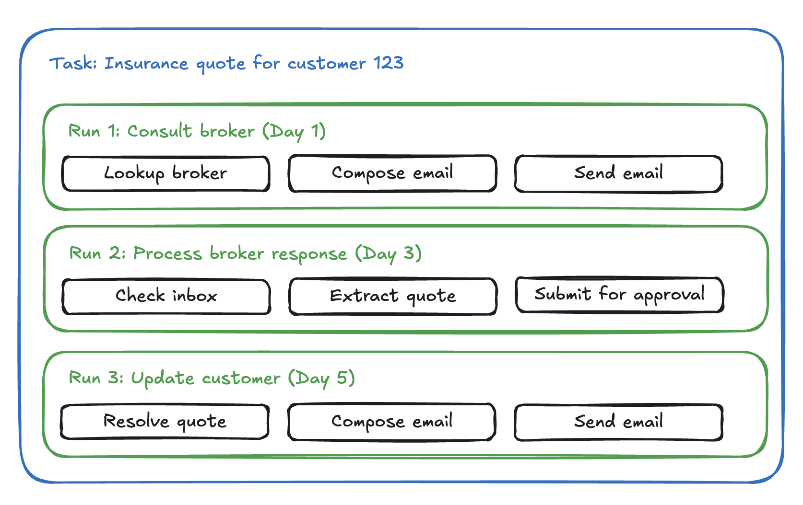
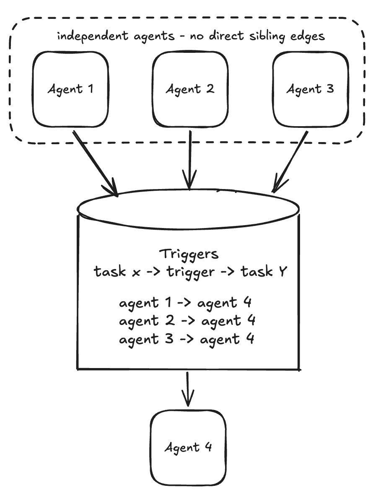
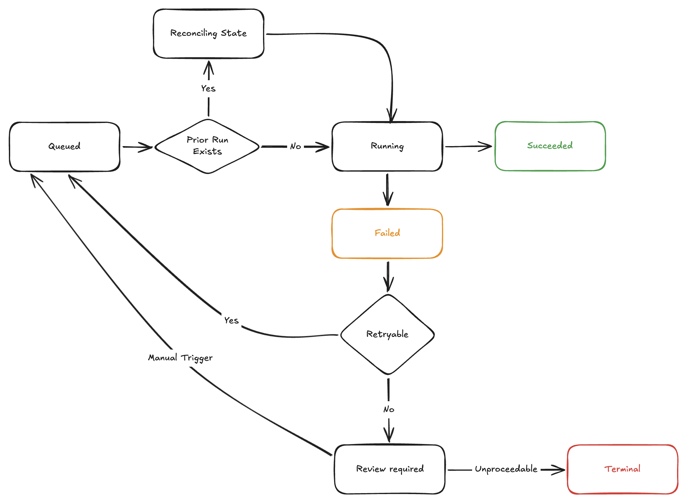
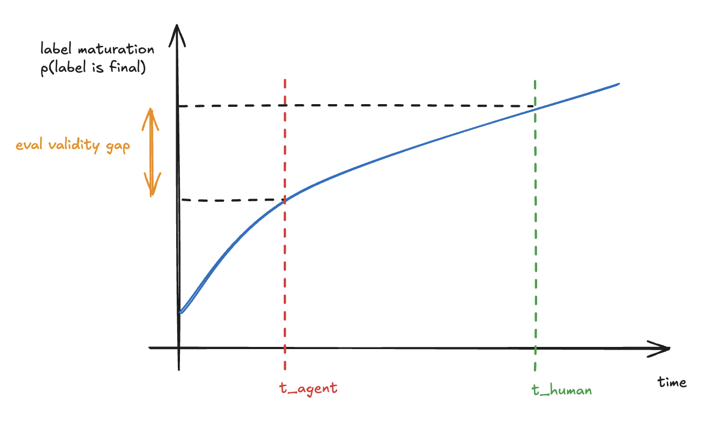
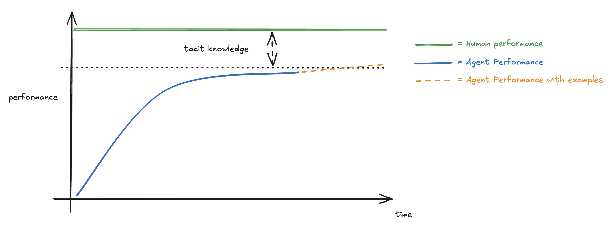
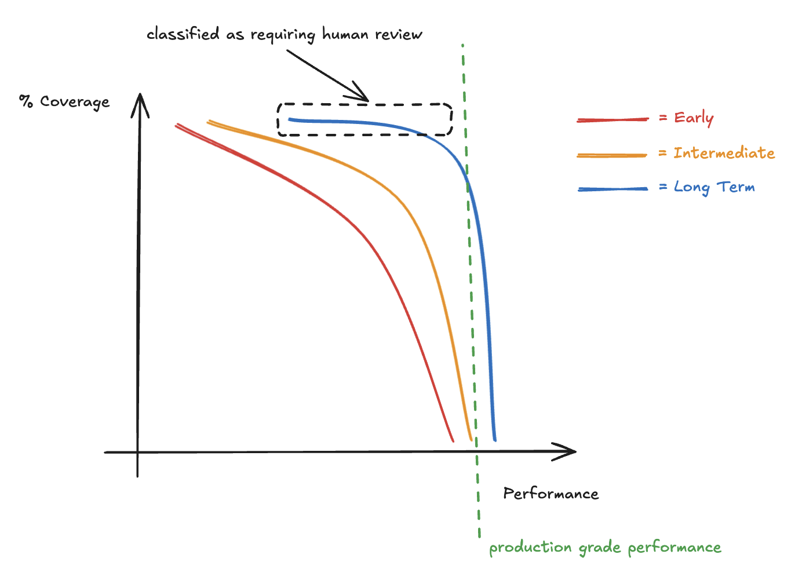

As a Principal Engineer at Faculty, I spent a year building an agent harness for large enterprises in regulated domains. Our goal was production-level performance. Details are anonymised.

This post covers how we stored and linked agent outputs, split agents along team lines, kept them running against APIs built for humans, and got accuracy up towards that of a human reviewer. 

## Our setup

We used a lightweight, domain-agnostic data model. Every agent emits **steps**: a record of actions it actually took (e.g. "read the document", "emailed the broker"). A **run** is a single invocation, an ordered set of steps. The agent asserts whether the run succeeded; the harness does not infer it ("email server was down, run failed"). A **task** is the business outcome, such as "insurance quote complete", and it owns many runs. The run history is what a later run reads to continue the task. An insurance quote that takes three weeks of broker correspondence is one task and N runs. Each run picks the workflow up with whatever new information has arrived, and nothing sits paused in between.

<figure class="figure-80">
  
  <figcaption>The data model in practice: one insurance quote, three runs spanning five days.</figcaption>
</figure>

The harness holds no domain knowledge. "Get a quote by doing X" never enters it, and domain behaviour is picked up by convention-based discovery. Customisation sits with three roles: a builder who has the domain knowledge and writes the agent, a dashboard user who works from its outputs, and a manager who owns the production bar.

We built first-class support for eval-driven development. In a regulated domain the production bar is near-human accuracy and a record that stands up in an audit, so roughly 75% of the engineering went into measuring agent performance rather than building agents. Once an evaluation was cheap to run, it was obvious whether a change had helped.

## Modelling the org as a DAG

A business decision is rarely one agent's output. "Offer this insurance quote" depends on several determinations, each owned by a different team with the domain knowledge to build its own agent. We wanted every team to be able to ship without understanding the others, so we modelled the dependencies as a DAG with agents as nodes and cross-team dependencies as edges. It is Conway's Law applied on purpose.

On a successful run the harness derives a trigger from the output and writes it as a row, `task X → trigger → task Y`, in a database we already ran. A downstream agent subscribes to the triggers it depends on, and when one fires it loads the upstream task's state from the shared model and continues. That row is the contract between teams: emit a trigger on success, subscribe to the ones you need. Nobody had to coordinate synchronously with another team to ship.

The rows double as the provenance record. In a regulated domain you have to answer "why did the agent do this", and here the answer is a query over the chain of triggers behind an output, available at the moment the decision is made. "Why didn't the agent run" is a query too. A trigger is only written on success, so a failed upstream run leaves no row and the downstream agent never starts. That stops failed runs from cascading. It does nothing for a run that succeeds with a wrong output, because the agent asserts its own success, and catching those is the job of the evals and triage described further down.

<figure class="figure-60">
  
  <figcaption>Organisation dependencies modelled as a DAG: agents are nodes, triggers are edges.</figcaption>
</figure>

## Retryable runs

The internal APIs these agents called were built for people using dashboards. Machine-to-machine auth was rare, and the APIs were sized for human throughput. An agent clears in minutes a queue a team would have worked through over a day, and at that rate the APIs we depended on degraded or failed.

So we modelled agents as retryable at the run level, a variant of durable execution (Temporal, Azure Durable Functions). A run succeeds or fails, a failure is classified as retryable or terminal, and retryable failures are re-enqueued.

The awkward part is that side effects from a failed run have already happened: an email was sent, a broker was contacted. A retry has to work out what the earlier attempt did and continue past it, so that however many runs a task takes, the broker gets that email once. Working that out is domain reasoning, so the agent does it, from the raw record the harness supplies. Builders paid for this by having to write the reconciliation, and we accepted that because an agent that cannot be retried safely cannot run at production volume.

In exchange, the same contract works across orchestration providers. Where a provider could resume mid-run, reconciliation handed control back into the run in place. Where it could not, the reconciliation check made a restart from the top safe. Operators also had a dashboard action to retry a failed run with context the agent did not have.

<figure class="figure-90">
  
  <figcaption>Agent retry flow with state reconciliation.</figcaption>
</figure>

## Right-censored labels

In fraud and insurance the label is right-censored. At decision time you observe that a confirming event has not happened *yet*. "The user has not completed ID verification" is a different claim from "they never will". The label matures as those events resolve, so a decision recorded early sits on a less mature label than the same decision recorded later. The response is `f(query, t)`, where most evals assume `f(query)`.

A human team worked a queue over a day, and labels matured during that lag before the decision was recorded. An agent clears the same queue in minutes, so every decision moves earlier in label-time. Measured accuracy drops, and the agent is no worse than it was: the eval is scoring an early decision against a reference label observed later, once it had matured.

<figure class="figure-90">
  
  <figcaption>The agent decides before the label has matured.</figcaption>
</figure>

The textbook fix is an as-of filter that reproduces the world at T. Most internal APIs have no notion of T, and where one existed it was not built for thousands of concurrent eval runs. These are the same APIs as in the retry section, and they capped how fast we could read historical state. The full set rarely finished overnight, so it ran periodically, while a label-balanced subset weighted toward the failures that kept recurring ran daily.

We also could not snapshot the original decision to make the eval reproducible. The reviewer had fetched that data through their own tools, outside the harness.

So we instrumented what the agent actually received. Every HTTP response could be hashed and stored, and runs were ordered so a disagreement could trigger a re-run against fresh labels. The harness flagged when the API's answer had materially changed between the two calls. A disagreement then splits in two: the agent was wrong, or the upstream answer had changed.

With that in place we could evaluate fairly against systems that fail and data that changes. What was left was a real gap to human accuracy.

## Tacit knowledge and triage

The remaining gap was tacit knowledge: the judgement an experienced person accrues doing the role. We wrote down as much of it as we could, and on many tasks the agent's accuracy and recall then flattened short of the human reviewer's.

We tried injecting salient examples at inference time. It helped only when the retrieved examples were highly relevant. These tasks are ambiguous and the model anchored on whatever it was shown, so a marginally relevant neighbour caused regressions. Few examples cleared the bar: in exploration, a usefully close neighbour existed for 2% of validation-set runs.

Raising that share means a denser example store. Once the agent was live, every confirmed failure in the rollout review collected a label of correct, incorrect, or partial and a free-text reason, and both went into the store.

<figure>
  
  <figcaption>Example injection once accuracy has flattened.</figcaption>
</figure>

Density accumulates slowly, and some cases will never have a near neighbour. For those we used a cheap triage model (LightGBM) to pick out the hard cases and route them to human review. In the harness these checks are post-processing nodes downstream of the domain agent, inside the same run and task as far as the dashboard user is concerned.

The domain agent runs inside higher-order nodes that enforce the production bar, which takes the builder off the hook for aggregate performance. The manager owns the threshold.

<figure class="figure-90">
  
  <figcaption>Segmenting tasks so the ones that clear the bar can run, and the rest go to review.</figcaption>
</figure>

## Confidence from the outputs

Part of a reviewer’s job is knowing when to ask for help. They can get a second opinion from a colleague or leave a case open until more information comes in. We could ask the agent how sure it was, but its answer wasn’t reliable enough to decide when someone should step in.

Our triage model decided which cases went to a reviewer using only information available before the agent ran. We wanted to know whether the answer itself could improve that decision. We tried four things:

- Running the same case several times and measuring how often the answers agreed (self-consistency).
- Asking a second model to grade the answer.
- Looking at the probabilities the agent assigned to its answer tokens.
- Asking the agent how confident it was.

With the number of cases sent for review held fixed, adding these signals to the triage model made no clear improvement in the proportion of errors it caught. We still had cases where the answer looked plausible and a reviewer found a mistake.

We used hosted models, so we couldn’t inspect their activations. I wondered whether there was anything in the model’s internal state that could have helped us pick out those cases.

## What I still don’t know

In our initial tests, only 2% of cases had a past example close enough to help. Every time a reviewer confirmed an error, we added another example. I’d like to know how often those examples helped the agent handle a similar case later, and which cases kept coming back to an experienced reviewer.

I’d also go back to the run history. We recorded what the agent saw and which tools it called. If I had a fixed number of cases a person could review each day, would looking at that record help me send them more of the mistakes? That’s the comparison I’d want before drawing any conclusions about what access to the model’s internals was worth.