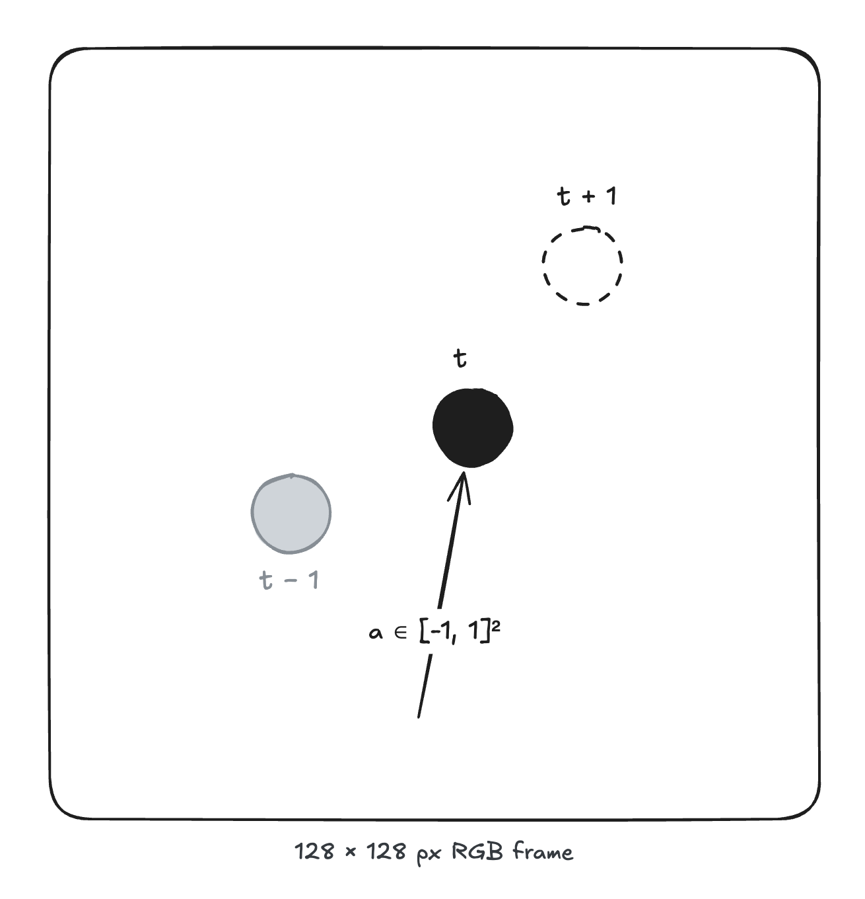
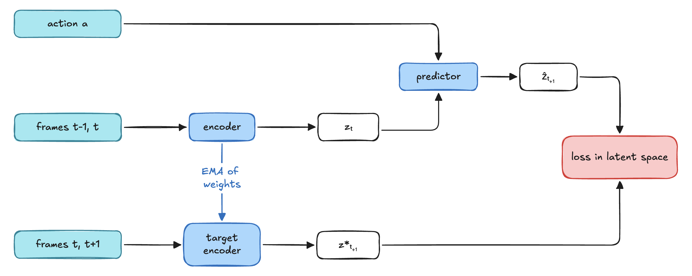
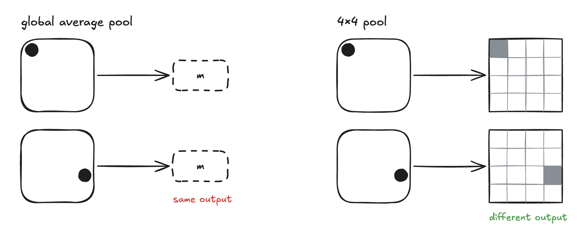
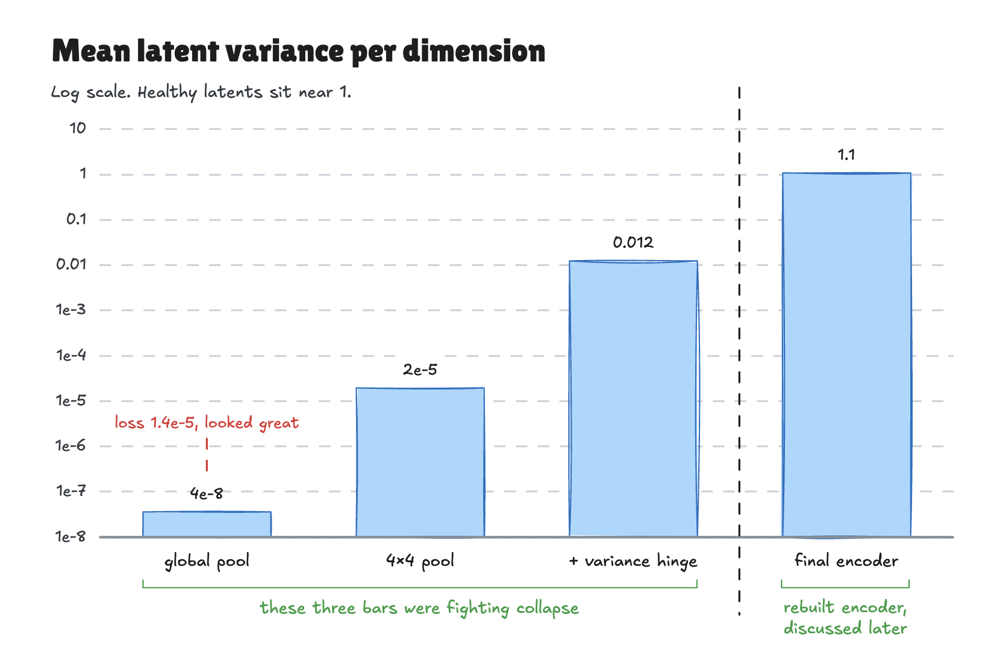
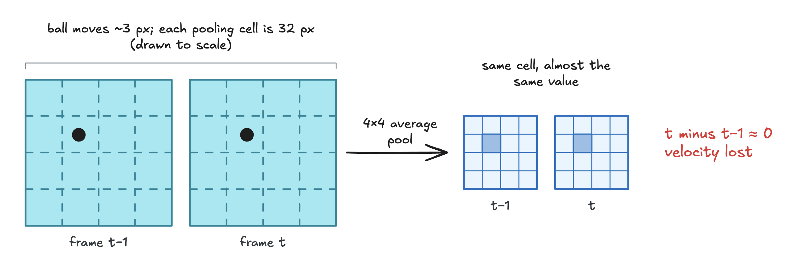
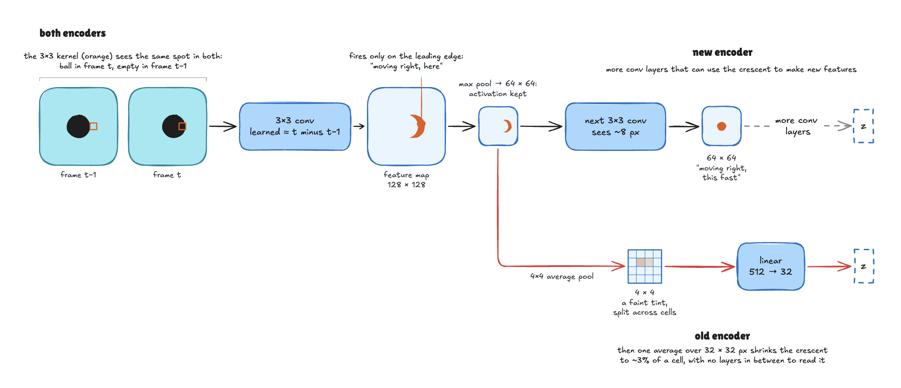
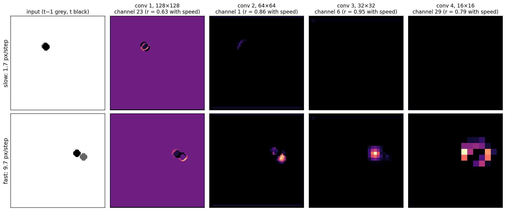

> Collapsed and then inaccurate: Probe R² 0.45 against 0.93 recoverable from the pixels, traced to 4×4 pooling and raised to 0.79 by a rebuilt encoder.

*Part 1 of 3. [Part 2: making a world model roll out](/2026/11/19/world-model-part-2-rollouts/) · [Part 3: planning in latent space](/2026/11/21/world-model-part-3-planning/)*

I’ve spent the last few years building around models rather than training them. For this series, I trained a JEPA from scratch to see where it would break and whether I could use it to control a simple environment.

## Building a useful latent representation

JEPA is a self-supervised architecture: pixels in → encoded to latent space → latent predictor → loss against encoded target. By predicting in latent space, JEPA can ignore extraneous, hard-to-predict details. The output is non-generative: there is nothing to read, sample or look at. Instead of LLM-style next token outputs, the model produces continuous embeddings.

JEPA is a representation learner. This project focuses on transitions: the predictor is trained to learn the effect of actions on the latent state, which is what makes the model useful for planning.

## The setup

The toy world is a ball in a 128 × 128 px arena. The ground truth is the ball’s position and velocity, recorded over N episodes of T steps. At t = 0 the ball is at rest in a random position within the arena. At each timestep the ball is perturbed by a force. The model predicts the next latent state, given the action. The closest published study is [Sobal et al. (2022)](https://arxiv.org/abs/2211.10831), which trains JEPAs on an action-controlled moving dot with background distractors and probes the representation for its location. I left out the distractors and added momentum, because the goal is a planning controller that moves the ball to a target, and that needs velocity as well as position.

<figure class="figure-40">
  
  <figcaption>The toy world: ball at t−1, t and t+1, a 2D action, 128 × 128 px frame.</figcaption>
</figure>

Early runs trained on 100 episodes of 10 steps: ~900 transitions, split 80/20 by episode (720 train, 180 test). This later grew to 1,000 episodes of 20 steps (~15k training transitions).

All ground truth data comes from these Euler steps:

<figure class="equation">
\[
\begin{aligned}
&\text{State:} && \mathbf{p} = (x, y), \quad \mathbf{v} = (v_x, v_y) \\[6pt]
&\text{Action:} && \mathbf{a}_t \in [-1, 1]^2 \\[6pt]
&\text{Velocity update:} && \mathbf{v}_{t+1} = \mathbf{v}_t + \frac{s\,\mathbf{a}_t}{m}\,\Delta t \\[6pt]
&\text{Position update:} && \mathbf{p}_{t+1} = \mathbf{p}_t + \mathbf{v}_{t+1}\,\Delta t \\[6pt]
&\text{Constants:} && s = 2, \quad m = 1, \quad \Delta t = 1
\end{aligned}
\]
<figcaption>The Euler equations used to generate the simulation data</figcaption>
</figure>

The encoder sees only the rendered frames. The predictor then has to match the target representation using only the encoded frames and the action.

<figure class="figure-wide">
  
  <figcaption>JEPA architecture: frames t−1, t are encoded by the online encoder and the target encoder encodes t, t+1. The predictor's job is to match the target, using only the online representation and the action.</figcaption>
</figure>

Frames are stacked ((t−1, t) and (t, t+1)) because one frame isn't Markov: the next state depends on velocity, and a single frame shows only position. Away from the walls, two frames give the model the information it needs: velocity is recoverable as the displacement between them.

The first encoder and predictor designs were deliberately small: one convolution, then a pool straight down to the latent.

```python
# 6 input channels: RGB frames t-1 and t, stacked
encoder = nn.Sequential(
    nn.Conv2d(6, 32, kernel_size=3, padding=1),
    nn.ReLU(),
    nn.MaxPool2d(2),  # 128 -> 64
    nn.AdaptiveAvgPool2d((4, 4)),  # 64 -> 4 (first runs: 64 -> 1)
    nn.Flatten(),
    nn.Linear(32 * 4 * 4, 32),  # z: 32 dims
)

predictor = nn.Sequential(
    nn.Linear(32 + 2, 32),  # input: [z, action]
    nn.ReLU(),
    nn.Linear(32, 32),  # output: predicted z at t+1
)
```

## A good loss on a collapsed encoder

Early training runs showed a promising latent loss: 1.4e-5. But the latent variance was ~4e-8 per dimension across the batch. Every frame was being encoded to the same vector.

This is a common failure mode with JEPA. The target encoder's weights are a slow moving average (EMA) of the online encoder's, and no gradients flow into it (stop-gradient). If both encoders output a constant, the loss is zero. Here, EMA and stop-gradient were not enough to stop collapse.

### The encoder couldn't see the ball

The total input size is 2 frames × 3 channels × 128 pixels × 128 pixels: 98k dimensions. After a conv layer, the representation is 32 × 128px × 128px: 500k dimensions. At some point the encoder has to condense that down to the 32-dimensional output.

The first version of the encoder used a global average pool to map every 64×64 feature map to a single value. That is common where position doesn't matter to the task ("does this image contain a dog?"), but a transition model needs to know where the ball is. I replaced the global pool with a 4×4 pool, which keeps coarse position. The change was needed for transitions to register, but on its own it barely moved the variance (see below).

<figure class="figure-80">
  
  <figcaption>A global average gives the same output wherever the ball is; a 4×4 pool keeps which cell it's in.</figcaption>
</figure>

### Using the loss to require variety

To stop the encoder putting every observation at the same point in latent space, I added a variance hinge to the loss. It sets a minimum std for each latent dimension across the batch, and any dimension below it adds to the loss. The threshold γ can be tuned, and the hinge's share of the loss monitored. This is the variance term from [VICReg](https://arxiv.org/abs/2105.04906).

$$
\mathcal{L} \;=\; \underbrace{\frac{1}{D}\,\big\lVert \hat{\mathbf{z}}_{t+1} - \mathbf{z}^{*}_{t+1} \big\rVert^2}_{\text{prediction}}
\;+\; \underbrace{\frac{1}{D}\sum_{j=1}^{D} \max\!\big(0,\; \gamma - \operatorname{std}_{\text{batch}}(z_{t,j})\big)}_{\text{variance hinge (added)}}
$$

```python
z = encoder(frames_t)  # (batch, 32)
z_hat = predictor(torch.cat([z, action], dim=1))
z_target = target_encoder(frames_t_plus_1)

prediction = F.mse_loss(z_hat, z_target)

# spread of each latent dimension across the batch
std = z.std(dim=0)
variance_hinge = F.relu(GAMMA - std).mean()  # GAMMA = 1

loss = prediction + variance_hinge
```

### Not collapsed, not yet good

With the 4×4 pool alone, variance only rose to 2e-5. Adding the hinge took it to 0.012 in the first run (a std of ~0.11, against the γ = 1 the hinge asks for), and with full training every dimension cleared γ: per-dimension std of 4.0–7.5. The encoder was no longer collapsed. But did its latents contain the ball’s position and velocity? To find out, I trained some probes.

<figure class="figure-90">
  
  <figcaption>Mean latent variance per dimension (log scale). The first three bars are the fight against collapse (the third from the first run with the hinge; with full training the std rose to 4–7.5 per dimension); the last is the rebuilt encoder from later in this post (with LayerNorm so not directly comparable).</figcaption>
</figure>

## Using probes to move back out of latent space

A probe tests the representation by regressing it against the ground truth data. The probes in the table below read the online encoder's latent for frames (t−1, t) and predict the ball's state at t. For the rebuilt encoder (row 3), a small MLP beat ridge regression clearly (0.79 vs 0.61 on vx, 0.82 vs 0.61 on vy). Velocity is in z, but curved.

The latent contains information about the state, more for position than velocity. But how good could those R² scores be? To find out, I measured how much of the state could be recovered from the pixels themselves.

The simulation is a black ball in a white arena, so the ball's centroid can be found by averaging pixel values. That gives position directly, and velocity as the displacement between frames. The simplified wall bounce keeps this ceiling below 1: on the ~5% of steps where the ball hits a wall, the displacement between frames no longer matches its velocity.

From the pixels, velocity is recoverable at R² 0.93 / 0.94. So why was the encoder's velocity so far below that?

Row 1 is good on position and weak on velocity. Its median velocity was 15 px/step, so my first guess was that frequent wall bounces were making velocity hard to recover. I tested this with a sweep of the force applied at each step. Lower speeds had the opposite effect: in row 2, at a median 3 px/step, the model captured almost no velocity information.

**Probe R² (MLP, held-out episodes)**

| | Test rows | x | y | vx | vy | vx ceiling | vy ceiling |
|---|---|---|---|---|---|---|---|
| Median velocity 15px/step | 180 | 0.96 | 0.95 | 0.45 | 0.47 | 0.93 | 0.94 |
| Median velocity 3px/step  | 180 | 0.95 | 0.95 | 0.14 | −0.16 | 0.93 | 0.94 |
| Rebuilt: deeper encoder | 3,800 | 0.97 | 0.97 | 0.79 | 0.82 | 0.93 | 0.94 |
{: .table-wide}

The evidence pointed to the pooling granularity. The encoder averaged the 128×128 grid to 4×4, so each cell spanned 32×32. At 15 px/step the median step was about half a cell, and at 3 px/step about a tenth. Most transitions were averaged to the same position before any later layer could read the motion, which is why lowering the speed made things worse.

To test that idea, I trained a separate probe on the raw frames average-pooled to 4×4, with no learned encoder at all. On the row 1 data it scored the same as the trained encoder on velocity (vx R² 0.48 vs 0.46 in the same run), so the trained encoder did no better than plain 4×4 averaging. I decided to rebuild the encoder.

<figure class="figure-100">
  
  <figcaption>A 3 px step stays inside one 32 px cell, so after a 4×4 average pool both frames look almost the same.</figcaption>
</figure>

How much can these R² numbers be trusted? A score measured on a small test set is noisy: a different 180 test rows could give a noticeably different R². To size that noise, I re-scored each probe on 2,000 resampled versions of its test set (a bootstrap) and kept the middle 95% of the results. Row 1's vx could sit anywhere from 0.33 to 0.55; row 3, with its much larger test set, sits between 0.77 and 0.81 (vx) and 0.80 and 0.84 (vy). The row 1 → row 2 drop is bigger than that noise, but with one training run per setting the numbers alone were not enough. The 4×4 control gave me more reason to suspect the pooling.

## Rebuilding the encoder

The original architecture ran one convolution and then averaged straight down to 4×4, which left no layers to build useful features from that first convolution's output. So I deepened the encoder, with several convolutions in series.

<figure class="figure-wide">
  
  <figcaption>The old encoder averaged straight down to 4 × 4, shrinking the crescent to a faint tint (~3% of a 32 px cell) before any layer could read it. The new encoder stacks convolutional layers to gradually step down the grid size allowing features to develop.</figcaption>
</figure>

With this change the per-epoch loss grew rapidly: 27 → 8,712 → 48,835 → 83,109. Nothing in the setup fixed the size of the latents, so they were free to grow, and the target encoder, a slow copy of the online encoder, grew with them. Because MSE squares the difference, a modest growth in latent scale shows up as a huge loss: 27 → 83,109 is only about a 55× growth in scale.

### Taming a runaway loss

Growing latents are a problem for three reasons: the latent's size changes relative to the action being applied, the predictor keeps being pushed into regions it hasn't trained on, and the MSE no longer measures prediction quality.

I made three changes:

- LayerNorm added on the encoder output, likely the main fix. It is a per-sample operation: it rescales each latent vector to zero mean and unit spread across its 32 dimensions, so the latent scale can no longer drift. It works on a different axis from the hinge: LayerNorm normalises within one sample, while the hinge measures each dimension's std across the batch and pushes the model to spread it.
- Adam learning rate reduced from 1e-3 to 1e-4, slowing any drift.
- A gradient clip added, to put a ceiling on the size of any single update.

With these fixes in place, the loss stabilised and the probes reached row 3 of the probe table (Rebuilt: deeper encoder). Row 3 changed depth, LayerNorm, data, batch size, learning rate and epochs together, so the gain can't be pinned on depth alone.

The activations at each convolution layer of the trained encoder show what the depth is for: each layer builds on the last to extract velocity.

<figure class="figure-wide">
  
  <figcaption>The trained encoder, one channel per layer: the channel that tracks ball speed best. Conv 1 marks the edges where the ball changed between frames. By conv 2 a slow step leaves a thin crescent, and by conv 3 the channel is a speed detector (r = 0.95): near-silent for the slow step, bright for the fast one.</figcaption>
</figure>

## Shortcomings

The encoder no longer collapses, and the probes recover much of the state. But there are still some weaknesses:

- The predictor adds little. Copying the current latent already removes 73% of the error of guessing the mean (latent MSE 1.35 → 0.37). The trained predictor gets to 0.28: better than copying, but only by about a quarter of the remaining error.
- Bounces are a weakness. Away from the walls, probing the predicted latent recovers velocity at 0.77 / 0.80 (vx / vy) and probing the target encoder gives 0.83 / 0.86. Where the ball bounces, velocity recovery drops to 0.14 / 0.13. Two stacked frames can't show whether the ball has bounced yet. Stacking three frames would be the useful test.
- One run per configuration. Neither the JEPA nor the probe was retrained with different seeds, so the bootstrap intervals cover only the choice of test examples, not run-to-run variance.

[Part 2](/2026/11/19/world-model-part-2-rollouts/) moves from one-step optimisation to rollout performance.

## Takeaways

- It is hard to make even a simple physics simulator accurate. Wall bounces, update order, pixel resolution and force magnitude all matter, and they obscure model performance while you are building.
- Finding the root cause of a performance problem takes careful measurement. Is it the probe, the model, or an information ceiling? Are the readings within their confidence intervals? More rigorous measurement infrastructure up front would have saved a lot of time.
- Information ceilings matter. Without knowing how much a perfect model could recover, R² values are hard to read.
- Use a ceiling to find the gap and a control to find the cause: the 4×4 control probe matched the trained encoder, so the trained encoder did no better than the pool alone.
- Visualising channel activations didn't help as an investigative tool during the build. It was only useful afterwards, for showing what the working model does.

## Training details

| | Early encoder (rows 1–2) | Rebuilt encoder (row 3) |
|---|---|---|
| Encoder | 1 conv (32 filters, 3×3), max pool, 4×4 average pool, linear 512 → 32 | 4 × [conv 3×3, ReLU, max pool] (128 → 8), linear 2048 → 32, LayerNorm |
| Predictor | MLP 34 → 32 → 32, input [z, action] | same |
| Target encoder | EMA of the online encoder, momentum 0.99, no gradients | same |
| Loss | latent MSE + variance hinge, γ = 1 | same |
| Optimiser | Adam, lr 1e-3 | Adam, lr 1e-4, gradient-norm clip 1.0 |
| Batch size | 10 | 128 |
| Epochs | 100 | up to 1,000; stopped when the 20-epoch mean training loss improved by < 1% |
| Data | 100 episodes × 10 steps: 720 train / 180 test transitions | 1,000 episodes × 20 steps: ~15k train / 3,800 test transitions |
| Split | by episode, 80/20 | same |
| Probes | MLP 32 → 32 → 4 and ridge, on the frozen latent; standardised targets | same |
| Hardware | Apple M3 Pro laptop, CPU | same laptop, Apple GPU (PyTorch MPS backend) |
