*Part 2 of 3. [Part 1: learning a world model from pixels](/2026/11/16/world-model-part-1-pixels-collapse-probes/) · [Part 3: planning in latent space](/2026/11/21/world-model-part-3-planning/) · [Code](https://github.com/jackholt44/world-models)*

<figure class="figure-wide">
  <picture>
    <source media="(max-width: 799px)" srcset="/assets/img/world-model/rollout-models-mobile.gif">
    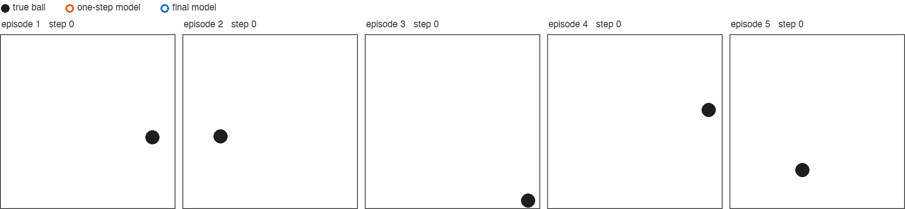
  </picture>
  <figcaption>The first five held-out test episodes. Black is the true ball position; the rings show positions decoded from each model’s rollout. The one-step model (orange) drifts towards the centre, while the final model (blue) follows the ball much more closely.</figcaption>
</figure>

> With more data, an updated loss and predictor, the model now rolls out five steps at R² 0.95 and over-reaches beyond that.


At the end of part 1, the encoder captured position well but was less accurate on velocity. The predictor didn’t add much: it improved on copying the current latent by only about a quarter of the remaining error.

## Is the predictor doing anything?

To see what the predictor adds, I probed four latents for the state at t+1: the current latent copied forward, the prediction ẑ with and without its action, and the target encoder's latent z*. Each probe is an MLP (32 → 256 → 256 → 4), scored as RMSE so the errors are in pixels:

| latent | position RMSE (px) | velocity RMSE (px/step) |
|---|---|---|
| current latent, no predictor | 2.75 | 1.90 |
| ẑ, action zeroed | 2.83 | 1.89 |
| ẑ | 2.69 | 1.57 |
| z* | 2.32 | 1.40 |

The predictor closes little of the position gap to z*, but about two thirds of the velocity gap. When I zero the action, the velocity gain disappears. The predictor seems to be learning the velocity change from the action and little else.

Most of its apparent fit comes from one-step transitions being easy: the next latent is close to the current one, so copying already scores well. Five steps ahead the ball has moved about 5 × vx, and copying no longer works. So the next thing to measure was a rollout.

## Rollouts drift towards the mean

A rollout feeds the predictor its own outputs to predict the latent N steps ahead: "_Starting from here, where is the ball after these 5 actions?_"

```python
z = z0
for a in actions:  # e.g. 5 actions
    z = pred(z, a)  # the prediction becomes the next input
result = z
```

My guess was that the error would compound and explode. Instead, rollout MSE levels off towards Var(z*) ≈ 1.35, which is what always guessing the dataset mean would score: it reaches 1.23 after 18 steps. Meanwhile the variance of ẑ across episodes drains away, to 0.18 against the targets' 1.35. (Here and below, variance and MSE are averaged over the 32 latent dimensions.)

<figure class="figure-90">
  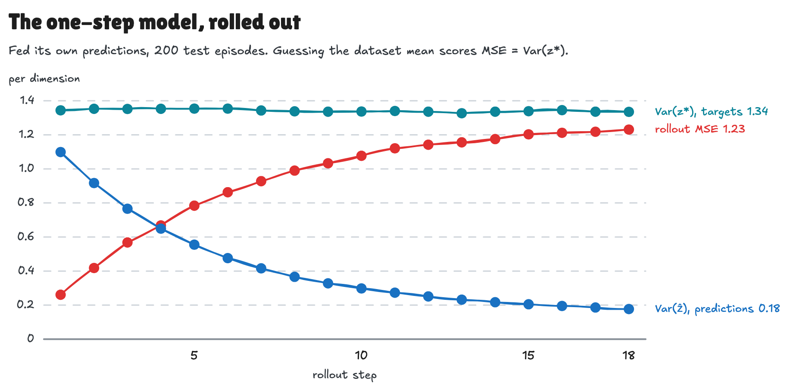
  <figcaption>The one-step model fed its own predictions. The error climbs towards the targets' variance, which is what always guessing the dataset mean would score, while the predictions' own spread drains away.</figcaption>
</figure>

Why are the predictions shrinking? An MSE model averages outcomes it can’t distinguish, so some shrinking is expected when it makes errors. I wanted to know whether this model was shrinking more than that. Comparing the predictions’ spread with their error gave me a way to check.

The loss offers an explanation. MSE rewards a prediction close to the average of the outcomes the model cannot distinguish. That average varies less than the outcomes themselves: the model hedges.

The latent does not pin down the next state exactly (part 1's encoder recovers velocity at R² 0.79), so the same input $$x$$ (current latent and action) can be followed by different targets $$z^*$$. Write $$\mu(x) = \mathbb{E}[z^* \mid x]$$ for their average. The expected error of any prediction $$\hat{z}$$, averaged over the $$D = 32$$ dimensions as the training loss is, splits in two:

$$
\frac{1}{D}\,\mathbb{E}\big[\lVert z^* - \hat{z} \rVert^2 \mid x\big]
= \underbrace{\frac{1}{D}\lVert \hat{z} - \mu(x) \rVert^2}_{\text{distance from the mean}} + \underbrace{\frac{1}{D}\sum_{j=1}^{D} \operatorname{Var}(z^*_j \mid x)}_{\text{spread of the target}}
$$

The second term doesn't depend on the prediction, so the best prediction is $$\hat{z} = \mu(x)$$, and the error it leaves is the spread, averaged over all inputs:

$$
\text{MSE} = \mathbb{E}_x\Big[\frac{1}{D}\sum_{j=1}^{D} \operatorname{Var}(z^*_j \mid x)\Big]
$$

Now take every target in the dataset. Their variance has two sources: different inputs have different means, and each input's targets spread around its mean. By the law of total variance the two add:

$$
\underbrace{\operatorname{Var}(z^*)}_{\text{all targets}}
= \underbrace{\operatorname{Var}\big(\mu(x)\big)}_{\text{between the means}}
+ \underbrace{\mathbb{E}_x\big[\operatorname{Var}(z^* \mid x)\big]}_{\text{within, the MSE}}
$$

For the optimal predictor the means are the predictions, so the first term on the right is $$\operatorname{Var}(\hat{z})$$, and the predictions have less variance than the targets by exactly the error that is left:

$$
\operatorname{Var}(\hat{z}) = \operatorname{Var}(z^*) - \text{MSE}
$$

A trained network isn't the optimal predictor, so this isn't guaranteed, but MSE training pushes towards it. Over every test transition, $$\operatorname{Var}(z^*) - \text{MSE} = 1.35 - 0.28 = 1.07$$, against a measured $$\operatorname{Var}(\hat{z})$$ of 1.09. The one-step predictor's outputs shrink by about as much as its error justifies.

I’ll use this relationship throughout the post. I call Var(z*) − MSE the **hedge line**: it is the spread an optimal MSE predictor would have for that error.

On the line, the predictor has the spread expected of an optimal MSE model. Below it, the outputs have shrunk more than the error justifies. Above it, they are overconfident.

Rolled out, the one-step model stays close to the hedge line, rising a little above it late on. (The table rolls out from the start of each of the 200 test episodes, which is why step 1 differs slightly from the all-transitions numbers above.)

| rollout step | MSE | Var(ẑ) | Var(z*) − MSE |
|---|---|---|---|
| 1 | 0.26 | 1.10 | 1.09 |
| 2 | 0.42 | 0.92 | 0.93 |
| 3 | 0.57 | 0.77 | 0.78 |
| 5 | 0.78 | 0.56 | 0.57 |
| 10 | 1.08 | 0.30 | 0.27 |
| 18 | 1.23 | 0.18 | 0.12 |

So shrinking towards the dataset mean isn't a fault in itself. It is what an MSE model should do when it is uncertain. Lower the error and the shrinking should go with it, as the animation at the top shows.

## Training on rollouts

The hedge line suggests that the shrinking reflects prediction error, and that reducing the error should reduce the shrinkage. I didn't see it that way at the time. I thought the problem was exposure bias: from step 2 on, the predictor is fed shrunken latents it never saw in training. So I trained on rollouts, feeding the predictor its own outputs and scoring each step against the target encoder's latent for that step:

```python
z = encoder(frames[0])  # online encoder, start of the window
loss = variance_hinge(z)  # only on the starting latent
step_losses = []
for h in range(H):  # H = 3
    z = predictor(z, actions[h])  # fed its own output from step 2 on
    z_target = target_encoder(frames[h + 1])
    step_losses.append(mse(z, z_target))
loss = loss + mean(step_losses)  # hinge and rollout weighted equally
```

I also lowered the hinge threshold from part 1's γ = 1 to 0.85. LayerNorm fixes each latent's spread across its dimensions, so with its gain at 1 the per-dimension variance across a batch can average at most 1. A γ = 1 hinge asks every dimension to sit at that ceiling. The hinge kept pushing, the LayerNorm gain inflated to about 1.3 over training, and the latent scale differed from run to run.

Trained this way with H = 3, test MSE bottomed out at epoch 6 and then rose, mostly from a worse fit:

<figure class="figure-90">
  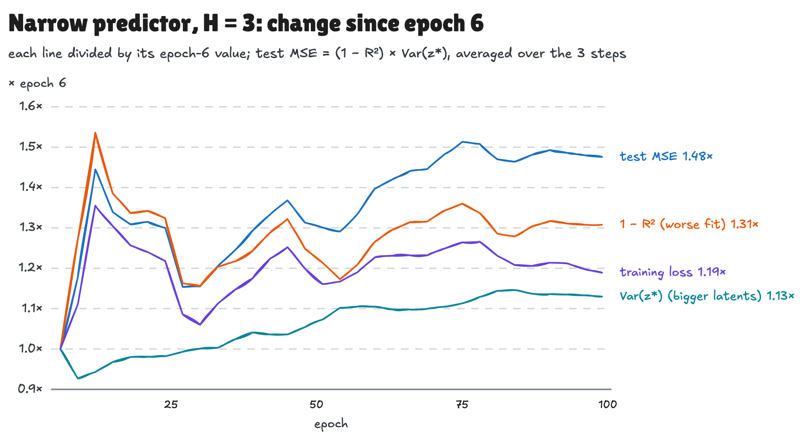
  <figcaption>Narrow predictor at H = 3, each line relative to epoch 6. Test MSE (1.48×) is the product of a worse fit (1 − R², 1.31×) and bigger latents (Var(z*), 1.13×).</figcaption>
</figure>

As a share of Var(z*), the training error barely moved (0.34 to 0.36) while the test error got 30% worse (0.33 to 0.43). Two things were happening:

- **The training fit stalled.** The predictor stopped improving on its own training data, and slipped back slightly, while the encoder kept reshaping the targets.
- **A generalisation gap opened.** Test MSE went from 0.96× the training loss to 1.20×. With only 2k parameters in the predictor, most of that is probably the 95k-parameter encoder fitting the 800 training episodes. The same gap comes back, larger, once the predictor is widened.

Why would the training loss rise at all, with gradient descent pushing it down? My best explanation is moving targets. The encoder kept changing, the EMA carried those changes into the targets, and the 2k-parameter predictor couldn't re-fit fast enough. I didn't ablate this (freezing the encoder mid-run would do it), but it pointed at the predictor, so I checked that next.

<figure class="figure-60">
  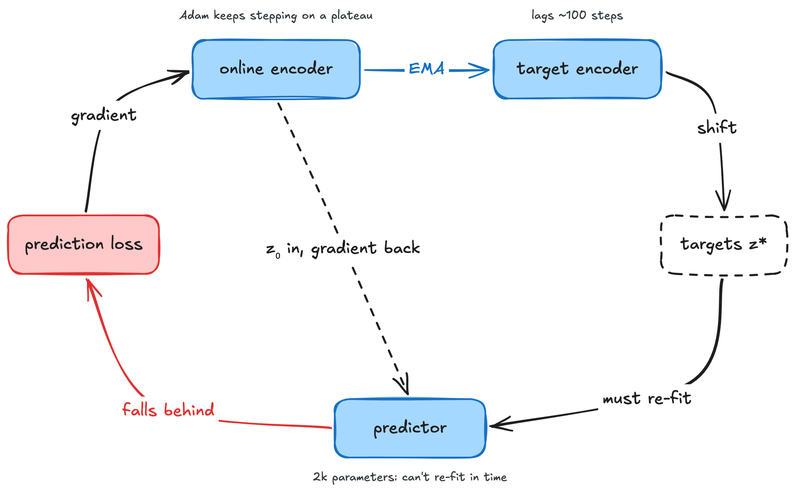
  <figcaption>The moving-target loop. The prediction loss reaches the encoder only through the predictor, but Adam keeps the encoder moving even when the loss is flat. Each step shifts the targets through the moving average, and a small predictor can't re-fit fast enough.</figcaption>
</figure>

## A wider predictor

To check capacity, I refit predictors of different sizes on frozen latents and scored them by one-step test R²:

| predictor | test R² | actions zeroed | conclusion |
|---|---|---|---|
| 34 → 32 → 32 | 0.734 | 0.720 | Actions add 0.01 R² |
| 34 → 256 → 256 → 32 | 0.814 | 0.722 | Actions add 0.09 R² |
| 34 → 512 → 512 → 32, residual | 0.798 | 0.698 | No gain over 256 |

The narrow predictor barely used the actions: zeroing them costs it 0.01 R². The 256-wide predictor gets 0.09 from them, and going wider again adds nothing, so 256 was the size to take forward. Retrained at H = 3 with the wider predictor:

<figure class="figure-90">
  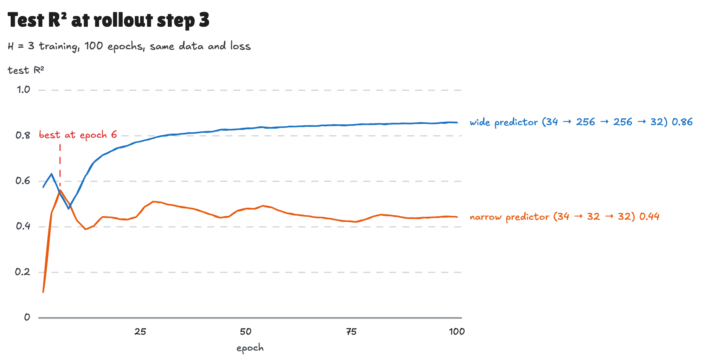
  <figcaption>Test R² at rollout step 3 over H = 3 training. The narrow predictor peaks at epoch 6 and loses ground; the wide one keeps improving.</figcaption>
</figure>

The predictor had been holding the model back. Widening it was one of the easier fixes in the project.

Against the hedge line, both predictors sit a little above it. Widening moved the model along the line: less error, more spread. The narrow predictor was trained on rollouts, yet by step 3 its predictions have about half the targets' variance (0.53, against the 0.44 its error allows). The rollout loss alone did not stop it shrinking.

<figure class="figure-60">
  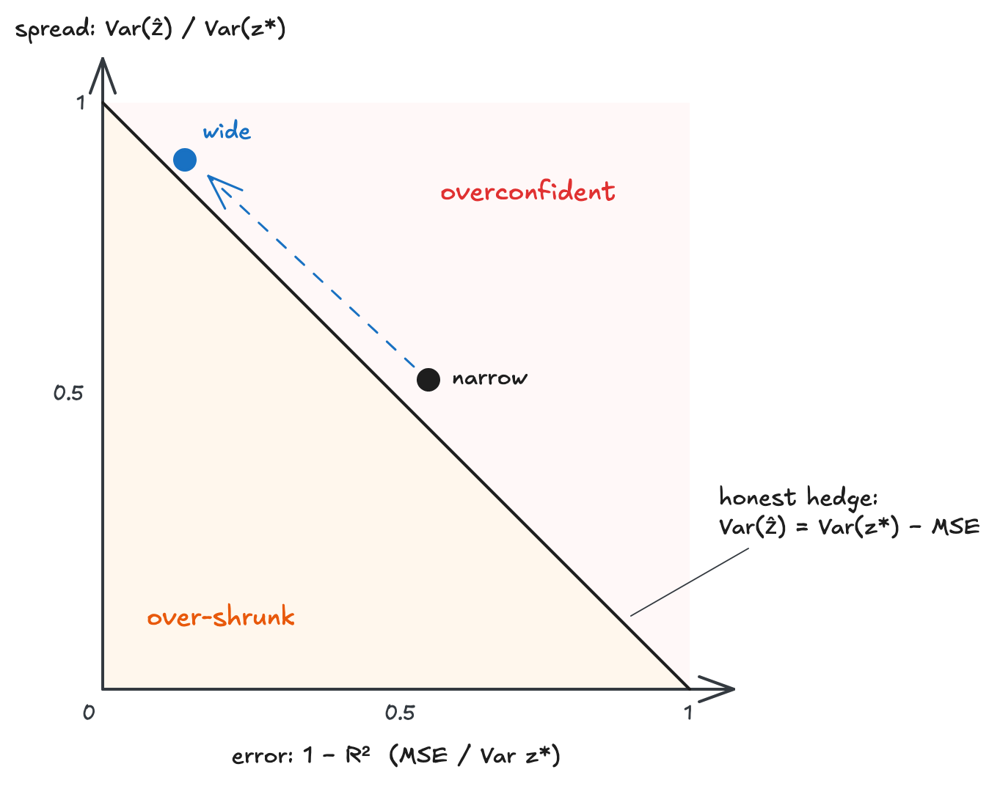
  <figcaption>The hedging check, with error and spread both as shares of Var(z*). The diagonal is the hedge line: on it, the outputs are as spread as their error allows. The points are the narrow and wide H = 3 predictors at rollout step 3. Both sit a little above the line, and widening moved the model along it.</figcaption>
</figure>

## Overfitting, then more data

With the wider predictor, test MSE was still falling when training stopped, so my first move was more epochs. I missed that train and test were diverging.

<figure class="figure-90">
  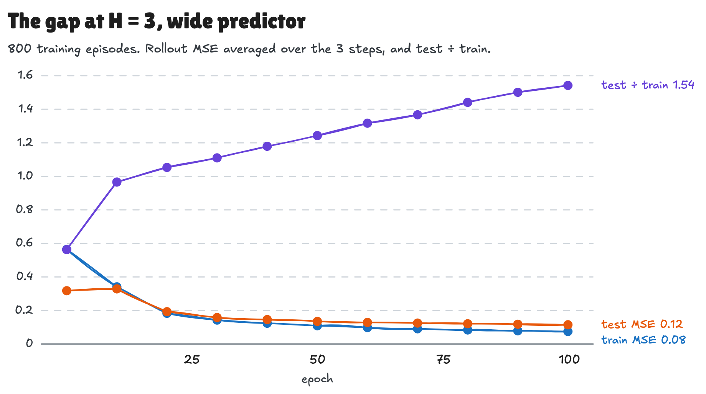
  <figcaption>The gap at H = 3, wide predictor, 800 episodes. Both losses keep falling, but test falls more slowly, so test ÷ train climbs steadily to 1.54×. A clear overfit pattern.</figcaption>
</figure>

At the same time I moved the training horizon from three steps to five, to match the planning horizon used in part 3, and trained on the same 800 episodes for 200 epochs.

Test MSE flattened by epoch 75 while training loss kept dropping. The extra epochs only fit the 800 episodes harder:

<figure class="figure-90">
  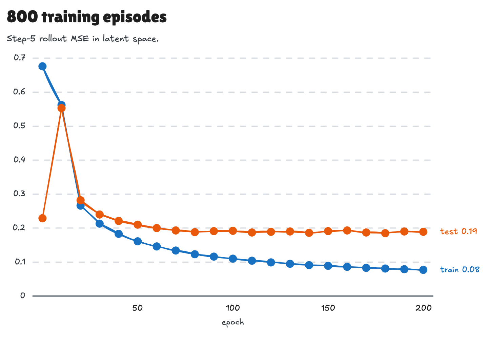
  <figcaption>800 training episodes, H = 5: test MSE flattens near 0.19 while training loss keeps falling to 0.08.</figcaption>
</figure>

More epochs were not the fix: the model had seen the same 800 episodes 200 times. So I generated more, 10,000 episodes with 9,000 for training. At the same ~18,800 gradient steps (epoch 200 of the 800-episode run, epoch 18 of the 9,000-episode run), each window has been seen 18 times rather than 200, and step-5 test MSE is 0.068 against 0.189:

| training episodes | gradient steps | passes per window | step-5 test MSE at ~18,800 steps | test / train at step 5, end of run |
|---|---|---|---|---|
| 800 | ~18,800 | 200 | 0.189 | 2.46× |
| 9,000 | ~59,000 | 56 | 0.068 | 1.10× |

With 800 episodes each seen 200 times, the model had many more opportunities to fit individual training episodes. With 9,000 episodes each seen 18 times, it had more varied examples from which to learn the dynamics.

<figure class="figure-90">
  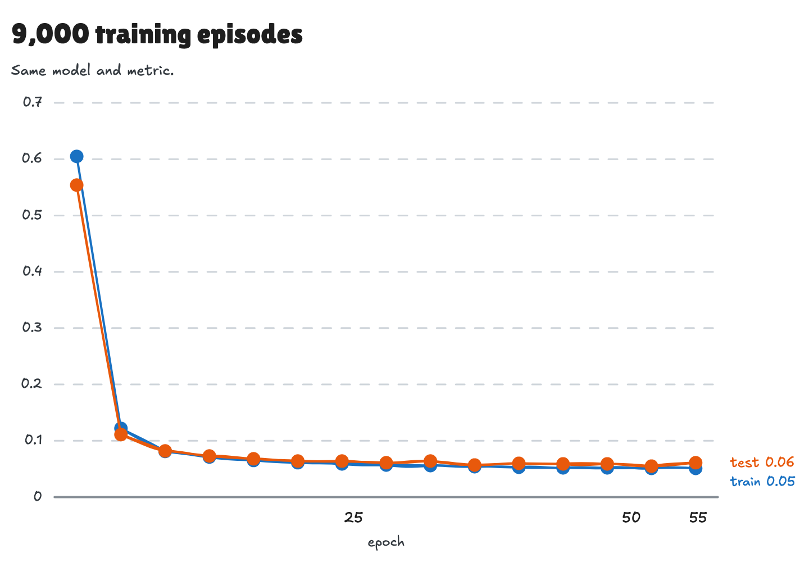
  <figcaption>9,000 training episodes: train and test stay together, ending at test 0.06 and train 0.05.</figcaption>
</figure>

## Beyond the training horizon

The final model has a step-5 test R² of 0.95. What happens if I roll it out beyond the five steps it was trained on?

The numbers in this section come from rolling out 19 steps from the start of each test episode, with variance taken across episodes. The 0.95 was scored on test windows starting anywhere in an episode, so the two differ a little: step-5 R² is 0.97 here.

The error keeps growing but the outputs keep their full spread. Up to step 5 the predictions sit on the hedge line. After that, Var(ẑ) stays near 1.05 while the hedge line falls to 0.57 by step 19. The predictions are overconfident: as spread out as if the model were still accurate.

<figure class="figure-90">
  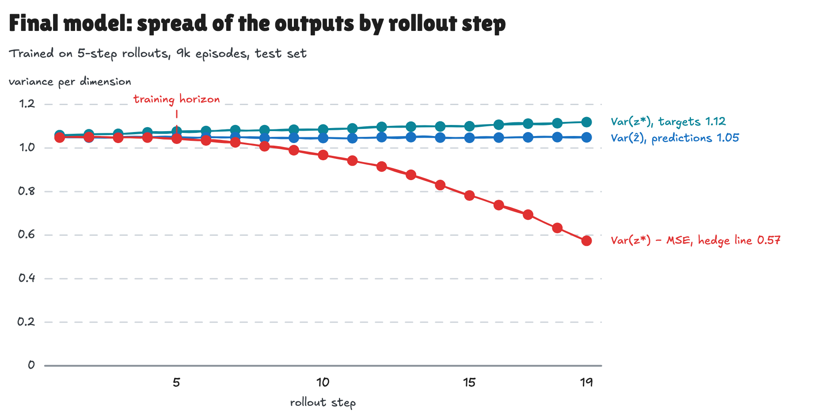
  <figcaption>The final model, trained on five-step rollouts. Up to the training horizon its outputs have the spread their error allows; beyond it the error grows but the spread does not, so the predictions are overconfident.</figcaption>
</figure>

Two different faults could put a model above the hedge line. Its predictions could all be shifted the same way (drift), or they could be spread wider than the truth supports (over-reach).

Call the distance above the hedge line the gap:

$$
\text{gap} = \operatorname{Var}(\hat{z}) - \big(\operatorname{Var}(z^*) - \text{MSE}\big) = \operatorname{Var}(\hat{z}) + \text{MSE} - \operatorname{Var}(z^*)
$$

Write the error as $$e = z^* - \hat{z}$$. The targets are the predictions plus the error, so their variance is the two variances plus twice the covariance:

$$
\operatorname{Var}(z^*) = \operatorname{Var}(\hat{z}) + \operatorname{Var}(e) + 2\operatorname{Cov}(\hat{z}, e)
$$

And the MSE is the error's variance plus its squared mean, the bias (how far the average prediction sits from the average target):

$$
\text{MSE} = \operatorname{Var}(e) + \text{bias}^2
$$

Substitute both into the gap. $$\operatorname{Var}(\hat{z})$$ and $$\operatorname{Var}(e)$$ cancel, which leaves:

$$
\text{gap} = \underbrace{\text{bias}^2}_{\text{drift}} \; \underbrace{-\, 2\operatorname{Cov}(\hat{z}, e)}_{\text{over-reach}}
$$

Plotting target against prediction shows the difference:

<figure class="figure-wide">
  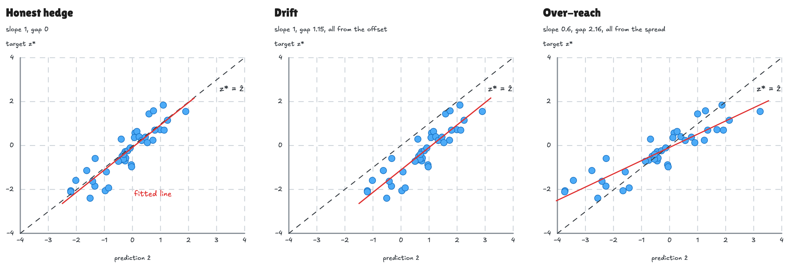
  <figcaption>Made-up points, plotted target against prediction; the dashed diagonal is z* = ẑ and the red line is the fitted slope. Drift moves the cloud off the diagonal but the fitted line stays parallel to it (slope 1). Over-reach flattens it (slope 0.6).</figcaption>
</figure>

With $$z^* = \hat{z} + e$$, the slope of the fitted line, pooled across the 32 dimensions, is

$$
b = \frac{\operatorname{Cov}(\hat{z}, z^*)}{\operatorname{Var}(\hat{z})} = 1 + \frac{\operatorname{Cov}(\hat{z}, e)}{\operatorname{Var}(\hat{z})}
$$

An honest hedge has slope 1: a unit change in the prediction comes, on average, with an equal change in the target. Over-reach flattens the cloud, because the truth moves less than the predictions do. The over-reach term is that shortfall in slope, scaled:

$$
\underbrace{-2\operatorname{Cov}(\hat{z}, e)}_{\text{over-reach}} = 2\,(1 - b)\operatorname{Var}(\hat{z})
$$

For the final model drift is under 0.005 at every step, so over-reach is almost all of the gap. The slope is 1.00 up to step 5, 0.96 at step 10 and 0.78 at step 19.

<figure class="figure-wide">
  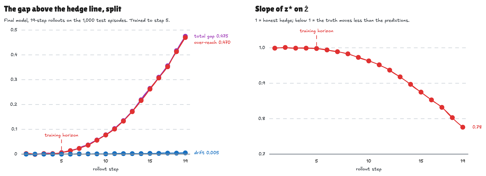
  <figcaption>The final model's gap above the hedge line, split. Over-reach is almost all of it; drift never passes 0.005. The slope is 1.00 to the training horizon and 0.78 by step 19.</figcaption>
</figure>

### What causes the overconfidence?

The gap grows with the error: 0.5% of the target variance at step 5, 7% at step 10 and 42% at step 19 (R² 0.97, 0.89 and 0.51).

The one-step model stayed near the hedge line, but the final model does not beyond its training horizon.

My best explanation is that neither model can see how much error its inputs carry: in a rollout, its own predictions look like ordinary latents. The one-step model shrinks by a similar share at every step; compounded, that shrinking happens to keep pace with its error. The final model was accurate enough over its five training steps that outputs on the hedge line retained almost their full spread. It may have learned to keep producing outputs at that scale even beyond the training horizon, where its error has grown.

I haven't tested this. If it's right, the fix is to show the model its own error in training: roll out further (H = 10 or more) so the later steps are trained onto the hedge line, or add noise to ẑ so its inputs look as uncertain as they are. An ensemble would go further and give the planner an uncertainty it can penalise.

So the two models fail in different ways. The one-step model is inaccurate, but its outputs shrink to match. Beyond step 5 the final model's error grows and its outputs don't shrink. That is a calibration failure.

## What the latent holds

The final model is accurate to five steps, using a 32-dimensional latent to carry four state variables. How much of that latent is about the state at all?

A probe from the latent to the state shows the state is in there, but not what else is. So I ran the test the other way: fit a linear map and a small MLP from the true state to the latent, and measure R².

| predicting, from the true state | share of latent variance | linear R² | MLP R² |
|---|---|---|---|
| the whole latent, 32 dimensions | 100% | 0.528 | 0.994 |
| principal component 1 | 32.9% | 0.876 | 0.999 |
| principal component 2 | 23.3% | 0.903 | 0.998 |
| principal component 3 | 13.7% | −0.013 | 0.997 |
| principal component 4 | 8.0% | 0.027 | 0.996 |
| principal component 5 | 5.9% | 0.007 | 0.995 |

These use the final model's one-step target latents on the 1,000 held-out episodes: fit on 800, scored on the other 200. The MLP scores 0.99, so the true state explains 99% of the latent's variance. There is almost no nuisance to remove, which is what you'd expect in a world with no distractors. The linear map reaches only 0.53: the first two principal components are close to linear in the state and the next three aren't linear at all. The latent representation is highly nonlinear.

That means distance between latents isn't a reliable measure of physical distance. If the latent were linear in the state, z = A·s + c for state s = (x, y, vx, vy), the distance between two latents would be ‖A·(s₁ − s₂)‖: a fixed, reweighted version of the distance between the two states. One pixel of movement would add the same latent distance anywhere in the arena. The ruler would be stretched but faithful.

With a nonlinear representation, none of that holds. The scale varies from place to place, so the same latent distance means different physical distances in different parts of the arena. Where the surface curls back on itself, states far apart in the arena can have latents close together. And the distance mixes position and velocity in whatever proportions the encoder happened to use. That matters for part 3, where the planning cost is a distance in latent space.

## Shortcomings

- One run per configuration, no seeds.
- The data-scaling comparison is scored on two different held-out sets. Between the 800-episode and 9,000-episode runs the test set changed from a random 200 of the old 1,000 episodes to a fixed set (the first 1,000 of the new 10,000). Batching was also optimised to cut training time, and the 9k run used bfloat16.
- Bounces are still aliased with two-frame stacking. Three frames not yet tried.
- The final 9k model was stopped by hand after 56 epochs while test MSE was still improving, so it may be slightly undertrained.
- Among the rollout-trained models, calibration beyond the training horizon was only measured for the final one. Training at longer H was not tried.

## Takeaways

The model now rolls out five steps at R² 0.95 and over-reaches beyond that.

- One-step error says little about rollouts. Measure error against horizon.
- Check Var(ẑ) against Var(z*) − MSE before blaming shrinkage. On the hedge line, the fix is a better fit (capacity, data).
- Before scaling data or compute, check the train/test gap to see which one is the limit.
- Change one thing at a time. The final model's rollouts no longer drain to the mean, but the loss, the predictor and the data all changed together, so I can't say for sure which fixed it. Two stories fit:
  - **The rollout loss did it.** Steps 2–5 are fed the predictor's own outputs and scored against the targets, so shrinking more than the step-k error justifies is penalised directly. One-step training never sees that compounding. Rollout MSE still rewards honest shrinking, though, so on its own this story can't produce full-scale outputs; that also needs low error.
  - **Accuracy did it.** An MSE predictor shrinks each step by about its own error. The one-step model's error was large, so it lost about a fifth of its spread per step and that compounded. The final model's step-1 error is about 0.01, so it would lose about 1% per step, with or without the rollout loss.

  The narrow H = 3 model already leans towards the second story: it was trained on rollouts and still shrank to about half the targets' spread by step 3. A wide predictor trained on one step only would settle it. If its rollouts drain, the rollout loss is what keeps the scale; if they hold, accuracy alone was enough.

## Training details

| | H = 3, narrow | H = 5, 9,000 episodes (final model) |
|---|---|---|
| Encoder | part 1's rebuilt encoder: 4 × [conv 3×3, ReLU, max pool] (128 → 8), linear 2048 → 32, LayerNorm; 95,136 parameters | same |
| Predictor | MLP 34 → 32 → 32, input [z, action]; 2,176 parameters | MLP 34 → 256 → 256 → 32; 82,976 parameters |
| Target encoder | EMA of the online encoder, momentum 0.99, no gradients | same |
| Loss | H-step rollout latent MSE, averaged over steps, + variance hinge on the starting latent, weighted equally; γ = 0.85, lowered from part 1's γ = 1 to stop the hinge fighting the LayerNorm | same |
| Optimiser | Adam, lr 1e-4, gradient-norm clip 1.0 | same |
| Batch size | 128 | 128 |
| Precision | float32 | bfloat16 forward pass, float32 losses |
| Epochs | 100 | 56; budget 100 with early stopping (patience 10) that never fired; stopped by hand; best checkpoint at epoch 54 by mean test MSE |
| Data | 1,000 episodes × 20 steps | 10,000 episodes × 20 steps, same simulator |
| Split | by episode: random 800 train / 200 test | by episode: fixed first 1,000 test, other 9,000 train |
| Probes | MLP 32 → 32 → 4 and ridge, on the frozen latent | MLP 32 → 256 → 256 → 4 (Adam, cosine LR over 200 epochs) and ridge |
| Hardware | Apple M3 Pro laptop, Apple GPU (PyTorch MPS backend) | same |

The first two sections use part 1's final one-step model; their probes use the wider 32 → 256 → 256 → 4 head.

The 800-episode H = 5 run in the data-scaling section uses the final model's encoder, predictor, loss and optimiser, on the old 1,000-episode dataset with a random 800 / 200 split, for 200 epochs.

Engineering that made the 9,000-episode run practical: frames kept as uint8 and cast on the GPU (46 → ~15 ms per batch), each batch gathered in one indexing operation (31 → 19 ms), bfloat16, and a folder per run with its `config.json` and `best.pth`.
