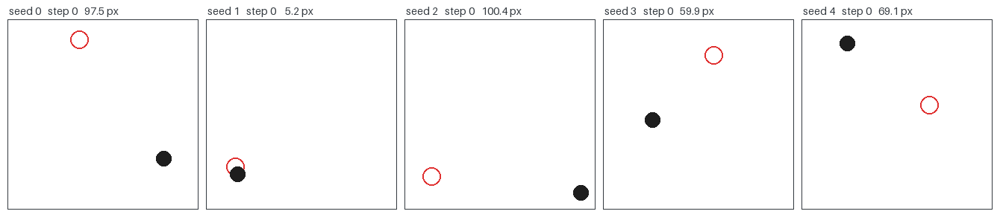
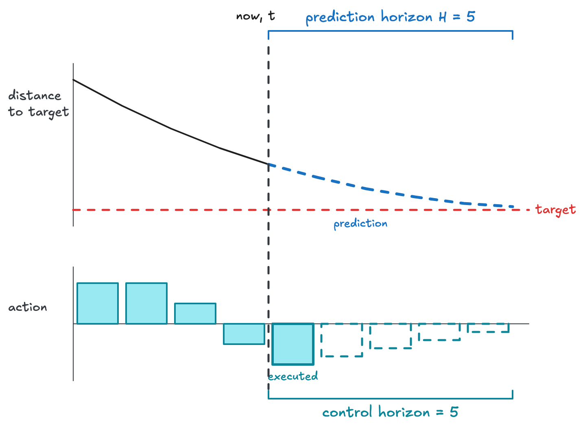
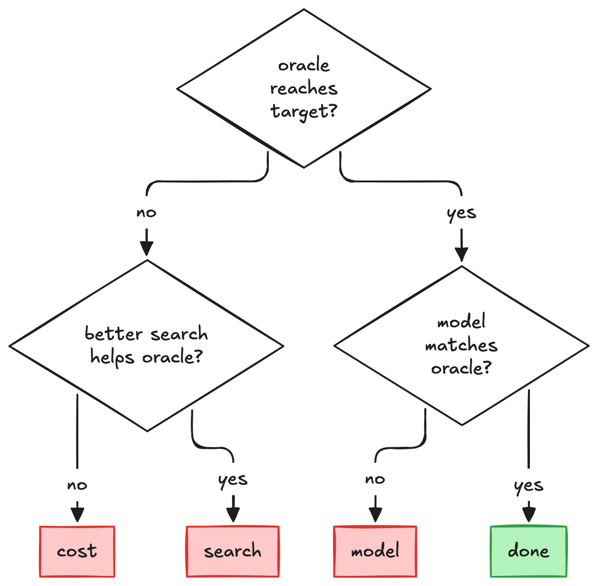
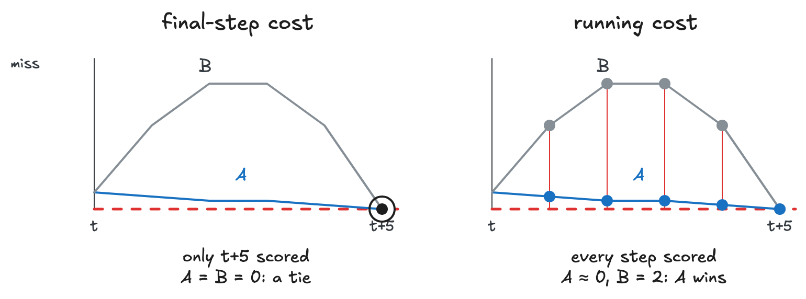
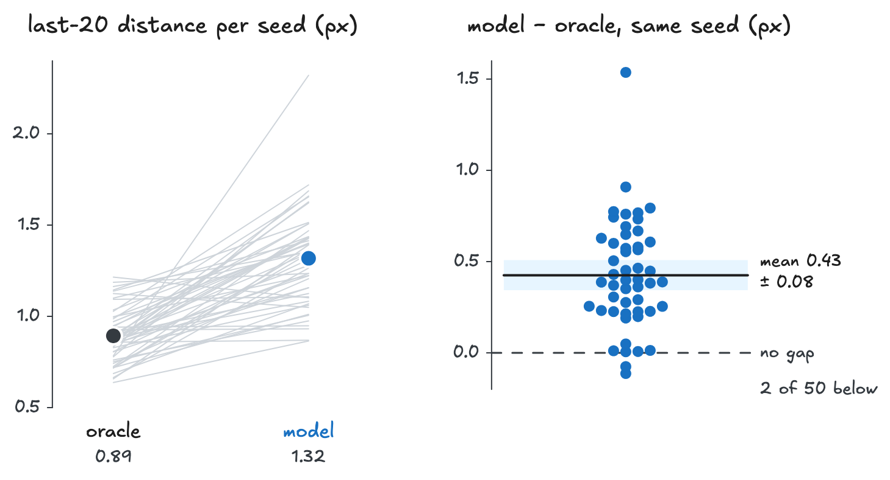
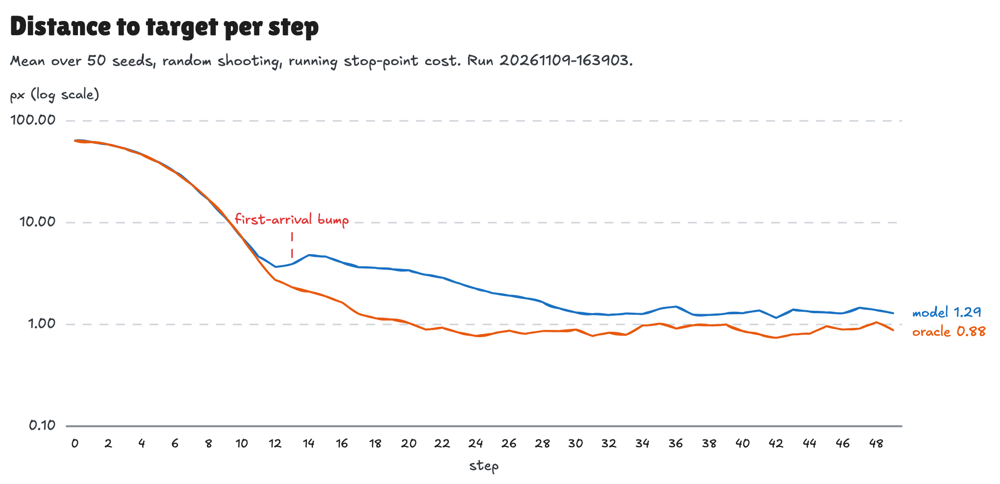
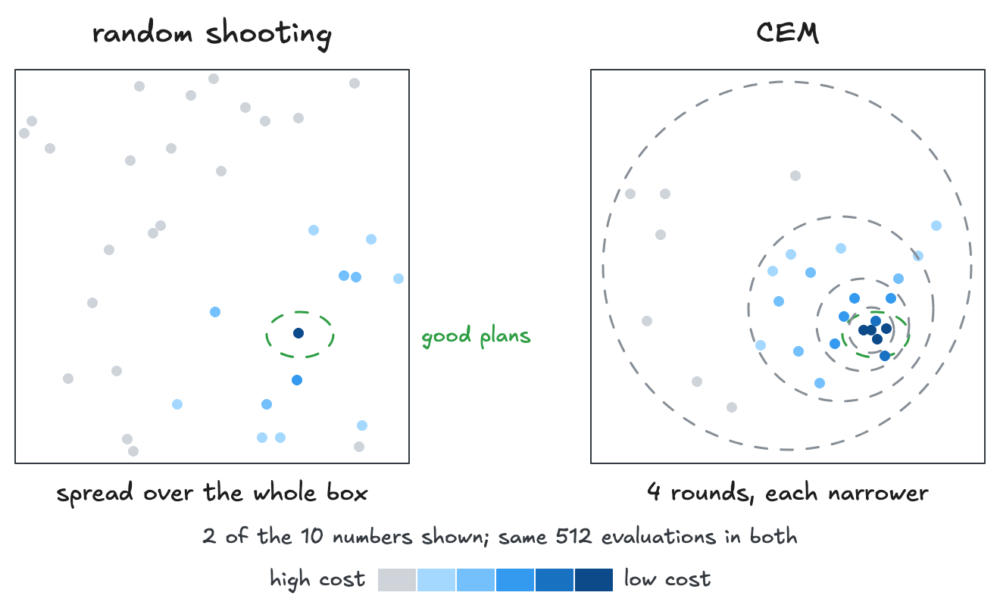
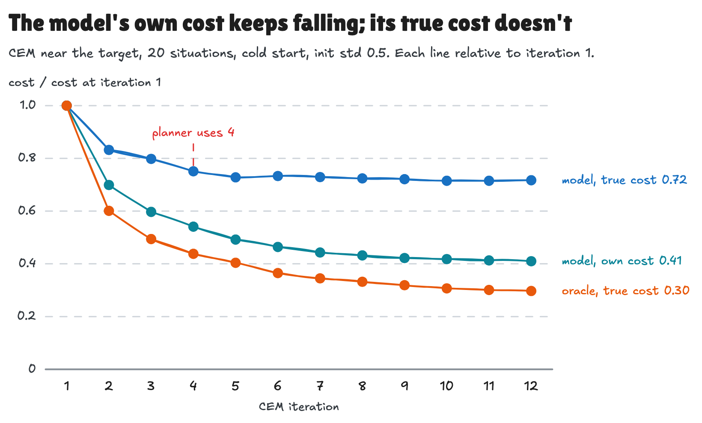

*Part 3 of 3. [Part 1: learning a world model from pixels](/2026/11/16/world-model-part-1-pixels-collapse-probes/) · [Part 2: making a world model roll out](/2026/11/19/world-model-part-2-rollouts/) · [Code](https://github.com/jackholt44/world-models)*

<figure class="figure-wide">
  <picture>
    <source media="(max-width: 799px)" srcset="/assets/img/world-model/mpc-rollouts-mobile.gif">
    
  </picture>
  <figcaption>The final planner (CEM, init std 0.5, latent goal cost) on seeds 0–4, not cherry-picked. Red ring: target. Final distances 0.8, 1.7, 0.2, 1.0 and 0.6 px.</figcaption>
</figure>

> With CEM search, the model planner settles within 0.9 px of the target, 0.56 px behind an oracle with a perfect model. The planners use different costs, so the gap combines model error and the choice of cost.

In part 2, the model learned to predict five steps ahead with an R² of 0.95, but became overconfident on longer rollouts. Now I’ll use it to plan actions that move the ball to a target. How close can it get, and what stops it getting closer?

## The planner

I started with a simple planner so that failures would be easier to diagnose: receding-horizon random shooting. At each step, it samples 512 candidate action sequences, each five steps long. It rolls them forward with the predictor, scores them and executes the first action of the best sequence. Then it replans.

<figure class="figure-80">
  
  <figcaption>Receding horizon, illustrative. Prediction and control horizons are both 5: each of the 512 candidate plans has 5 free actions. Only the best plan's first action is executed, then the window slides forward and the planner replans.</figcaption>
</figure>

## An oracle to separate model, search and cost

The oracle scores candidate plans using the true simulator instead of the learned model. If both planners use the same cost and search setup, the oracle can help me work out what’s holding the model planner back:

<figure class="figure-60">
  
  <figcaption>Reading the oracle. Each failure points to one of cost, search or model. A better search means more samples, or CEM at the same budget.</figcaption>
</figure>

I run the model and oracle on the same seeds and compare their results seed by seed. I expected that to account for shared difficulties, such as targets near a wall. In practice, their results on each seed are barely correlated, so pairing doesn’t make the comparison much more precise.

## Finding an effective cost function

My first cost function scored the ball’s position at the end of the horizon. Even the oracle hovered about 4 px from the target. I thought velocity might be the problem: a cost on position alone doesn't care if the ball arrives fast and overshoots.

So the next cost added the final step's stop point: where the ball would end up if it braked as hard as possible from that state. The 4 px hover remained.

A terminal cost may explain the hovering: it only scores the state at step H. A plan that drifts away and comes back by step H scores the same as one that stays on target, but only the first action is executed. Then the planner replans. Averaging the cost over all H steps favours plans that make early progress towards the target.

<figure class="figure-80">
  
  <figcaption>Illustrative. Both plans end on target. Scoring only the last step can't tell them apart; scoring every step can.</figcaption>
</figure>

Penalising overshoot barely changed the final distance; averaging over the horizon cut it by roughly 4× for the model and 6× for the oracle.

| cost, 10 seeds, final distance (px) | model | oracle |
|---|---|---|
| final position only* | 4.88 | 4.27 |
| position + stop point, final step only | 4.60 | 4.61 |
| position + stop point, averaged over H | 1.26 | 0.79 |

Rows 2–3 report distance at step 49 (these early runs logged steps 0–49).
*Early scratch run, 10 seeds, not in the main log.

The headline runs drop the plain position term, keeping only the running stop-point cost, and use 50 seeds. Over the last 20 steps ("last-20": mean distance over steps 31–50) the model averages 1.32 ± 0.07 px from the target and the oracle 0.89 ± 0.04 px.

<figure class="figure-90">
  
  <figcaption>Paired comparison, 50 seeds, random shooting, running stop-point cost. Left: each line joins one seed's oracle and model. Right: the same seeds as differences. The model is worse on 48 of 50 seeds. The per-seed values are barely correlated (r ≈ 0.06), so the gap shows because it is large relative to the spread, not because pairing cancels seed difficulty.</figcaption>
</figure>

The oracle settles by about step 20 and the model by about step 30. Even with the true simulator, the oracle stays about 0.9 px from the target, so there is still room to improve the cost or the search.

<figure class="figure-90">
  
  <figcaption>Mean distance to target per step, 50 seeds, log scale. Both approach and then hover; the model overshoots on first arrival and settles about 0.4 px above the oracle.</figcaption>
</figure>

## Planning without a probe

So far, the planner has scored states decoded by a probe trained on labelled simulator data. I wanted to see whether it could plan without that supervision. Part 2 showed that the true state explains almost all the latent’s variance, but the encoding is nonlinear, so distances in latent space may not reflect physical distances.

I encoded the target frame twice with the target encoder to make a goal latent representing the ball at rest on the target. The cost is the distance from each predicted latent to that goal, averaged over the horizon. No probe or label appears in the planning loop.

| last-20 dist (px) | model | success: dist < 2 and speed < 1 |
|---|---|---|
| probe stop-point cost (above) | 1.32 ± 0.07 | 0.48 |
| latent L2 | 1.44 ± 0.12 | 0.64 |
| latent L1 | 1.45 ± 0.13 | 0.44 |

I tried both L1 and L2 distances because the state is encoded nonlinearly. I thought L2 would perform worse by penalising large non-linear deviations in some dimensions. Both land within ~0.12 px of the probe cost, and L1 and L2 are indistinguishable.

## Better search

Each step's action is two continuous pushes in [−1, 1], so a 5-step plan is a point in the box $$[-1, 1]^{10}$$. Brute force means bucketing each number into $$k$$ levels, giving $$k^{10}$$ plans per step:

| levels per number | values | plans per step | smallest move |
|---|---|---|---|
| 2 | {−1, +1} | 1,024 | 2 px, no zero push |
| 3 | {−1, 0, +1} | 59,049 | 2 px |
| 5 | {−1, −0.5, 0, 0.5, 1} | ~9.8 million | 1 px |
| 11 | steps of 0.2 | ~26 billion | 0.4 px |

Settling within a pixel needs 5 levels or more: about 10 million plans per step, against a budget of 512. The cost surface is smooth though, so plans near a good plan are also good. A grid spends as much on hopeless regions as good ones. The cross-entropy method exploits the fact the cost surface is smooth to find low-cost plans with a far smaller budget than brute force would require.

<figure class="figure-80">
  
  <figcaption>Illustrative, 2 of the 10 dimensions; shade shows cost. Random shooting spreads its 512 samples over the whole box, and few are cheap. CEM spends the same 512 in four rounds of 128: sample, keep the best, resample around them.</figcaption>
</figure>

CEM comes from rare-event simulation: it repeatedly refits a sampling distribution to the best samples, so a near-optimal plan goes from rare to typical. Here that's a Gaussian per action, refit to the top 12 of 128 samples, four times. Under CEM, each planner runs its own search (same budget, own cost), so the candidates are no longer shared. The model planner scores with the latent cost and the oracle with the stop-point cost, so a gap between them now mixes model error with the choice of cost.

I also warm-start the search: each step begins with the previous plan shifted forward, since consecutive five-step windows share four steps. That lets the planner carry refinement from one step to the next.

### Wide CEM search pushes the model out of distribution

One seed (#8) runs away (~51 px last-20). It starts 96 px out, and the model planner accelerates to 23 px/step by step 8, faster than 99.9% of training states (16 px/step). There its one-step error grows to 10–25 px, yet it still predicts low cost for plans the simulator scores at 50–150 px, so it never brakes and bounces between walls at 20–27 px/step.

At std 0.5 the same seed overshoots too but brakes back and settles (last-20 0.6 px): a wider search has more room to find the extreme plans the model wrongly scores as good (at std 1.0 about a third of sampled pushes are clipped to full strength, so the search is dominated by full-throttle plans), and the wide spread overrides the warm start, so the planner keeps reversing instead of braking.

### The oracle benefits more from better search

CEM improves both planners, but the oracle benefits more.

| last-20 dist (px) | random shooting | CEM, std 1.0 | CEM, std 0.5 |
|---|---|---|---|
| model, probe cost | 1.32 | — | — |
| model, latent L2 | 1.44 | 1.97 (0.97 without seed 8) | 0.92 |
| oracle | 0.89 | 0.47 | 0.35 |

At std 0.5 the oracle stops on target (dist < 2 px, speed < 1) on all 50 seeds and the model on 42 (0.84).

The oracle gets more out of CEM than the model does. Would giving the model more time to search help? I tried 12 CEM iterations instead of four, in 20 situations where the ball was hovering a few pixels from the target.

The model's own elite cost keeps falling, but the true cost of its plan stops improving after about 4 iterations:

<figure class="figure-90">
  
  <figcaption>CEM near the target, 20 situations, cold start, init std 0.5, each line relative to iteration 1. The model keeps finding plans it scores better; the simulator stops agreeing after about iteration 4. The oracle's plans keep improving.</figcaption>
</figure>

After about four iterations, the model keeps finding plans it likes, but their true cost stops improving. In the final runs, the model planner sits 0.56 ± 0.15 px farther from the target than the oracle (paired, last-20). The model uses latent L2 and the oracle uses stop-point cost, so that gap reflects both prediction error and the choice of cost.

## Shortcomings

- All results use one trained model: the intervals don’t include run-to-run training variation; the exact gaps could shift with a retrained model
- A single toy task with no distractors: nothing here says the latent cost survives a harder scene. This was a learning exercise that intentionally relaxed that constraint.
- Bounces: input aliasing vs prediction error still not separated; three-frame input not tried. Bounces are rare in training data, and the model is weakest there (the seed 8 runaway bounced every few steps)
- Planning horizon capped at the training horizon (H = 5). Longer horizons would need training at H = 8–10 or noise on ẑ (part 2)
- Success-with-speed is below 1 for the model in every configuration
- The final model–oracle comparison uses different costs, so the gap cannot be attributed to model error alone. Running both planners with the same stop-point cost would give a cleaner comparison.
- CEM differs from random shooting in two ways: it refines iteratively and it remembers the previous plan (warm start). The gain is credited to better search, but the two weren't separated; CEM without warm start was not run

## What I would do next

- **Counterfactual reasoning.** I'd like to explore how the model responds when the environment changes, and whether its latent representation captures the cause of that change. [*Counterfactual World Models: JEPAs That Reason About "What If"*](https://arxiv.org/abs/2611.24778) offers a starting point for thinking about what might have happened under different conditions.
- Off-manifold check: do rollouts leave the surface the encoder produces, and does the planner exploit that?
- Residual predictor `z + f(z, a)`: copy-z already performs strongly. Would using a residual give the predictor more capacity to model the actions?
- Three-frame input for bounces: Aliasing is not fixable without moving to a three-frame input. Performance is very bad at bounces.

## Takeaways from the series

- **Measure beyond the training loss.** Probes, baselines and ceilings helped identify what the model had learned and where it was failing.
- **Make experiments easy to compare.** Reliable training and evaluation runners made it easier to isolate changes and revisit results.
- **Expect progress across the stack.** The largest gains came from a combination of data, model capacity, measurement and search. Designing the network was only one part of the work.

## Planning details

| | random shooting | CEM |
|---|---|---|
| Model | part 2 run `20261029-125202`, best epoch 54 | same |
| Candidates / budget | N = 512 sequences per step | 4 iters × 128 samples = 512 |
| Horizon | H = 5 | same |
| CEM | — | warm start from previous plan; elites = top 10% (12 of 128); init std 1.0 then 0.5; std floored at 0.05 |
| Costs tried | terminal position; terminal stop-point; running stop-point; latent L2 / L1 | model: latent L2; oracle: running stop-point |
| Episode | 50 control steps (distances logged at steps 0–50) | same |
| Seeds | 10 early, 50 headline | 50 |
| Success | dist < 2 px; dist < 2 px and speed < 1 | same |
| Intervals | 95% over seeds, 1.96 × SE | same |
| Hardware | Apple M3 Pro, MPS | same |
